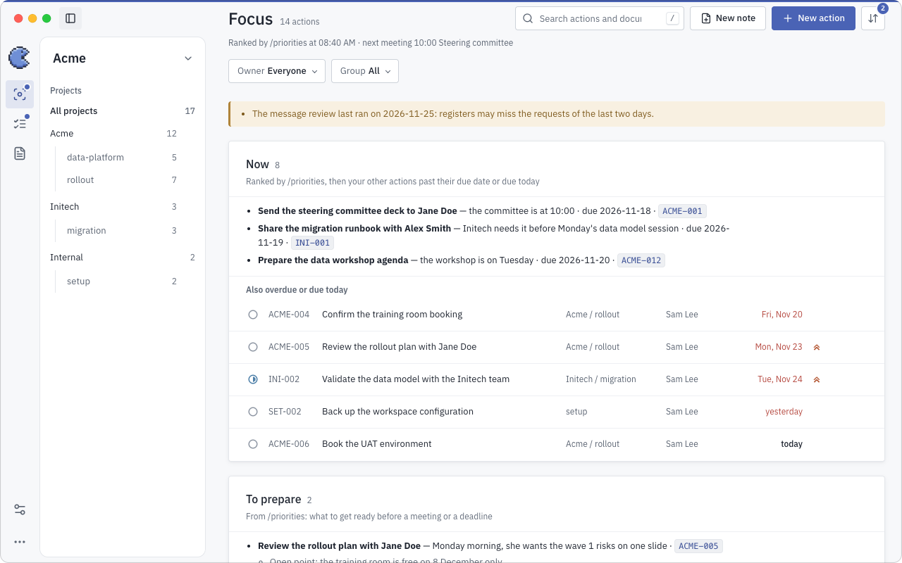
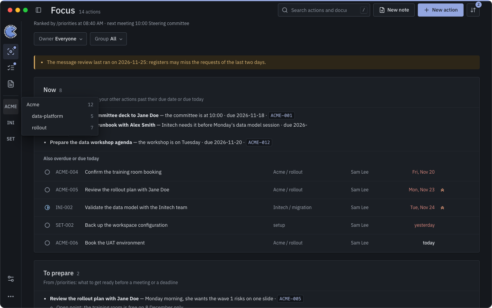

<p align="center">
  
</p>

<h1 align="center">Work</h1>

<p align="center">A workspace where your coding agent remembers each client's context and never mixes one with another.</p>

<p align="center">
  <a href="https://github.com/alpyt42/Work/releases"></a>
  <a href="https://github.com/alpyt42/Work/actions/workflows/release.yml"></a>
</p>

## The problem

- Every new Claude Code or Codex session starts without the context of the last one.
- Loading whole project files fills the agent's context window.
- With several clients on one machine, one client's data can end up in another's repository.

Work is a portable `Work/` workspace that fixes this. Memory lives in private Markdown repositories called brains, one per trust boundary. Agents read them through small commands that return only the part a question needs. Git hooks keep the boundaries intact. A local app, Corvus, lets you read and edit the same files without an agent. The repository holds the tools, the shared conventions and the checks. It holds no client data.



## Features

- **Private Markdown brains.** Each brain is its own Git repository and its own trust boundary, declared in `.data/brain.json` with the remote and e-mail it must use. Personal, employer and client data never share a repository. The repository ships no skill: skills live in the brains.
- **Context on demand.** `brain-state.py` loads output, not files: `brief` for where a project stands, `find` for a term or an identifier, `section` for one heading of a page, `person` for someone and what they carry, `due` for late and upcoming actions, `changes` for what moved since a date. Agents never read a register or a project page whole.
- **Action and decision registers.** `action.py` and `decision.py` write the registers, with length caps (35 words for a history entry, 40 for a timeline entry, 70 for a decision field). A commitment becomes an action only when four tests hold; otherwise it stays in the minutes or message where it was said.
- **Project archiving.** `brain-state.py archive` moves a finished mission, project or client into an `archive/` folder, rewrites the links, and refuses while an action is still open. An archived project leaves every command and every view. `unarchive` is the exact inverse.
- **Corvus, a local app.** `tasks-web.py` serves three sections on `127.0.0.1`, Focus (the `/priorities` ranking with the actions due), Actions (List, Board, Timeline) and Docs (with Archives), plus Settings (with Tools), a Sync button that counts the changes waiting online, and one search across actions and documents. A selector switches between brains. Sync saves and sends a brain's changed notes through its own Git hooks, and brings in the changes made on another computer as a fast-forward only. `install-app.py` installs it as an app on macOS, Windows and Linux, in a window of its own.
- **Guardrails.** Git hooks refuse staged secrets, the names of clients and people known to the other brains, malformed commit messages, dead or cross-brain links, and pushes with the wrong identity, a force push or a remote branch deletion. A Claude Code hook refuses direct `python`, deletions in the artifacts folder, hook bypasses and writes into an `artifacts/` folder not yet linked to the configured one. `preflight-push.py` runs before every push.
- **Obsidian compatible.** Open `Work/` as the vault. Each brain's `tasks.md` shows the registers as Tasks queries and a kanban, with a form to add an action.
- **Releases.** Every push to `main` is tested on Linux and released automatically from its Conventional Commits. Machines update to a release only, never to the tip of `main`, and an update never touches the brains.




## How it works

```
Work/
├── tools/          reusable scripts: brain/, machine/, repos/, tasks-web/
├── kit/            conventions, guides, templates and seed shared by every brain
├── brain/          private memory, its own Git repository
├── brain-<name>/   one more brain per trust boundary, each its own repository
├── repos/          code clones, each with its own repository
├── artifacts/      human-readable outputs and large inputs, local only
└── agents/         scratch space for agents
```

1. The agent gets a question about a client or a project.
2. It runs a context command (`brain-state.py brief`, `find`, `section`, `person`).
3. Only the part it needs enters the context window.

## Quick start

Configure Git and SSH identities first (see [`tools/machine/GIT-IDENTITY.md`](tools/machine/GIT-IDENTITY.md)), then:

```bash
git clone https://github.com/alpyt42/Work.git ~/Work
~/Work/tools/machine/install.sh --brain <private-brain-git-url> [--brain-perso <git-url|new>]
```

Without `--brain`, a blank brain is created locally from `kit/brain/seed/`. The script never touches home configuration, never commits or pushes, and can be rerun safely. Details are under [Set up a new machine](docs/SETUP.md#set-up-a-new-machine).

## Documentation

- [Setup and maintenance](docs/SETUP.md): layout, new machine (Windows included), another computer, updates, checks.
- [Brains, skills and tools](docs/BRAINS.md): trust boundaries, skills, repositories, Obsidian, the Corvus app.
- [`tools/README.md`](tools/README.md): index of every command.
- [`tools/machine/README.md`](tools/machine/README.md): install, update, hooks and releases.
- [`tools/machine/GIT-IDENTITY.md`](tools/machine/GIT-IDENTITY.md): Git author and SSH key per trust boundary.
- [`tools/tasks-web/README.md`](tools/tasks-web/README.md): Corvus, the local app.
- [`kit/brain/AGENTS.md`](kit/brain/AGENTS.md) and [`kit/brain/docs/README.md`](kit/brain/docs/README.md): brain conventions and guides.
- [`kit/obsidian/README.md`](kit/obsidian/README.md): Obsidian setup.
