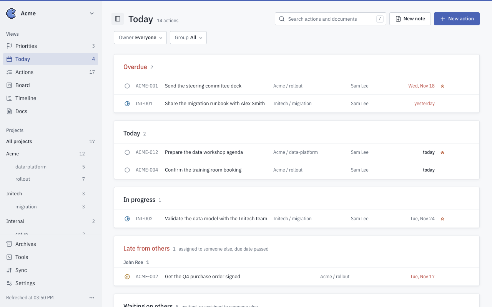
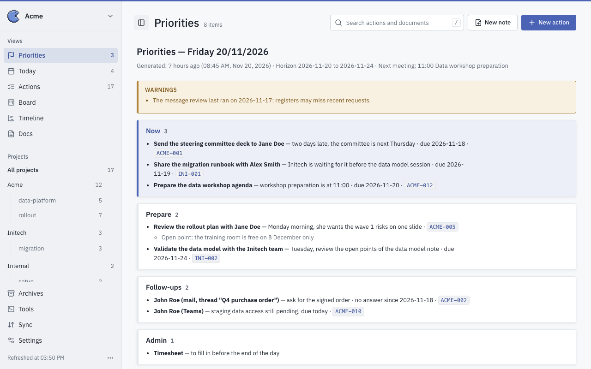
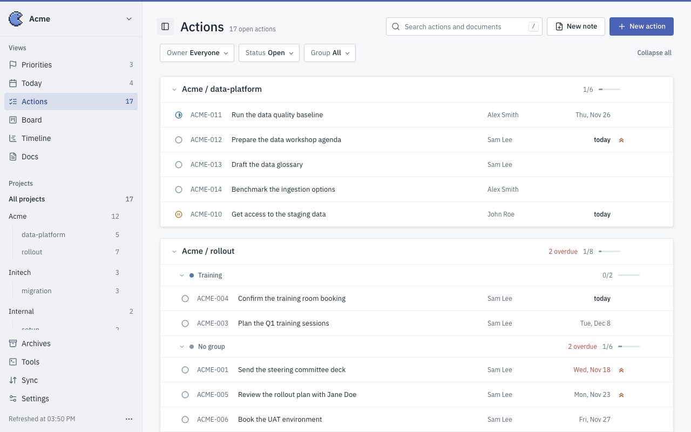
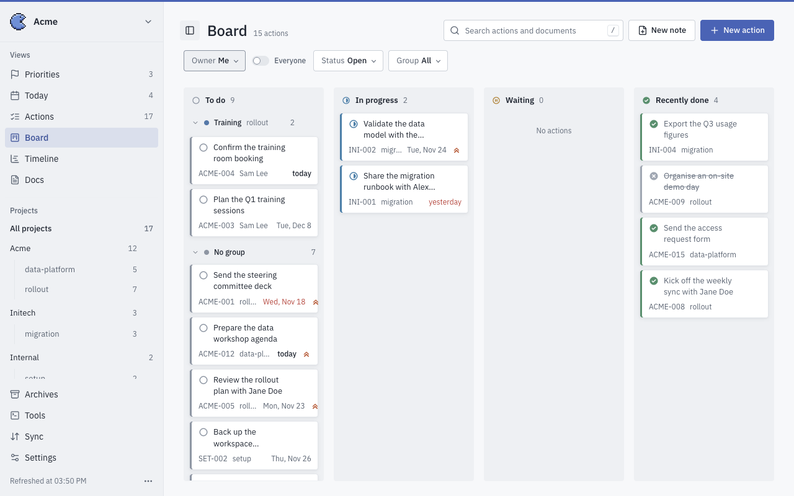
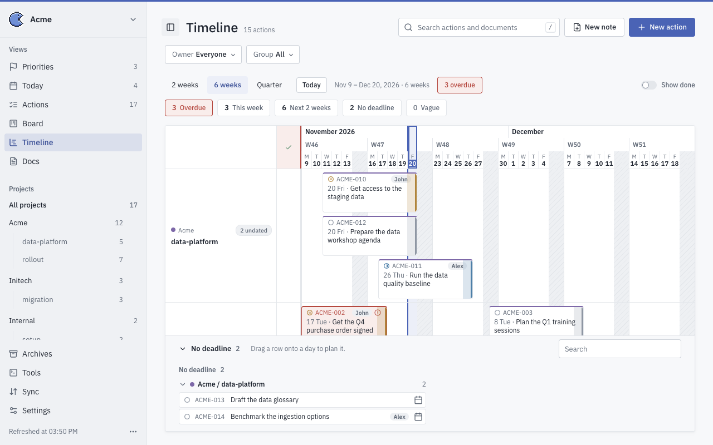

# Actions app

A local browser app that reads and edits the action registers and the notes of your brains, without an agent. It runs on your own computer only (`127.0.0.1`), stores no copy of your data and loads no network resource: no CDN, nothing fetched from the Internet. Back to the [root README](../../README.md).



## Launch

From the root of Work:

```sh
uv run tools/tasks-web/tasks-web.py
```

Then open `http://127.0.0.1:8765/` (`--port N` to choose another port, `Ctrl+C` to stop). `uv run` installs the one dependency on its own. `--brain <folder>` picks the default brain and `WORK_DIR` another Work root.

To start it from the Dock, the Start Menu or the applications menu instead, run `uv run tools/tasks-web/install-app.py` once: it adds an **Actions Brain** entry that starts the server when needed and opens the page (see [Install the app](REFERENCE.md#install-the-app)).

## Tour

### Today

The opening view: your overdue actions, those due today, those in progress, the follow-ups to make with others and what you wait on, then the week ahead. Each action appears once, in the first section that fits.

### Priorities

The ranking written by the `/priorities` agent skill for the current brain: what to do now, what to prepare, conflicts, follow-ups. An action ID in an item opens that action.



### Actions and the detail panel

Actions are listed by project and group, each with its progress and overdue count. A click on the status or the due date changes it in place; a click on a row opens the detail panel with the fields, the subtasks and the history of notes. Every write goes through `action.py` and can be undone.




### Board

Four columns, To do, In progress, Waiting and Recently done. Drag a card to change its status. It shows your own cards unless you switch to Everyone.



### Timeline

Actions with a deadline on a chronological frieze (2 weeks, 6 weeks or a quarter), one lane per project, overdue first. Those without a deadline wait in a tray below: drag one onto a day to plan it.



### Docs and search

The notes, sources, workstreams, journal and project pages of the brain, with a reader and a Markdown editor for working notes. The search field, in every view, looks through the actions and every Markdown document at once.


### Brains

The button at the top of the sidebar switches brain without restarting the server; each brain has its own colour and pixel logo. **Add brain** creates a new private brain from the seed, with its own Git repository. A sideways swipe over the sidebar moves to the next brain.


### Icon rail and dark mode

The `[` key folds the sidebar to a rail of icons, each named in a tooltip. The page follows the light or dark setting of the system.


### Update

When a new release of Work exists, an **Update** button appears in the sidebar. The dialog shows the release notes and, once confirmed, a step bar through the install. Archives, Tools, Sync (save and send a brain's changes) and Settings sit below it; see the reference.


## Keyboard shortcuts

The single keys do not apply while typing in a field; `?` shows their help, and the tooltips recall them.

| Key | Effect |
|---|---|
| `/` | Search the actions and the documents |
| `n` | New action |
| `0` to `5` | Priorities, Today, Actions, Board, Timeline, Docs |
| `j` `k`, `↓` `↑` | Next or previous action (Today, Actions, Board, Timeline) |
| `←` `→` `↑` `↓` | On a Timeline chip: by date, and by project |
| Alt `←` `→` | On a Timeline chip: move its deadline by a day (with Shift, a week) |
| Enter | Open the details of the selected action |
| `s` | Status menu of the selected action |
| `d` | Due date of the selected action |
| Esc | Close the menu, the drawer or the panel; in the search field, clear it and go back to the view it left |
| ⌘ Enter | Save the panel or the note being edited |
| ⌘ Z | Undo the last write |
| `[` | Collapse the sidebar to its icons, or expand it (the drawer, under 900 px) |
| `?` | Shortcuts help |
| ⌘ B, I, U, K, ⇧ ⌘ X | In a note being written: bold, italic, underline, link, strikethrough |

In a list, only the selected row (otherwise the first one) is in the tab order: Tab goes through its buttons, `j` and `k` move to the others.

## Reference

[`REFERENCE.md`](REFERENCE.md) holds the rest: [install the app](REFERENCE.md#install-the-app), [layout](REFERENCE.md#layout), the views and their routes ([Priorities](REFERENCE.md#priorities), [Today](REFERENCE.md#today), [Actions](REFERENCE.md#actions-and-detail-panel), [Board](REFERENCE.md#board), [Timeline](REFERENCE.md#timeline), [Groups](REFERENCE.md#groups), [Docs and Search](REFERENCE.md#docs-and-search), [Archives](REFERENCE.md#archives), [Tools](REFERENCE.md#tools), [Sync](REFERENCE.md#sync), [Update](REFERENCE.md#update), [Settings](REFERENCE.md#settings)), [several brains](REFERENCE.md#several-brains), the [priorities file format](REFERENCE.md#priorities-file), [data and security](REFERENCE.md#data-and-security) and the [code layout](REFERENCE.md#code-layout).
