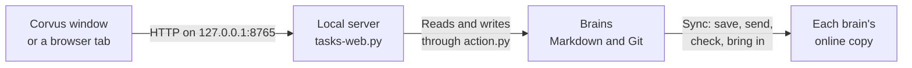
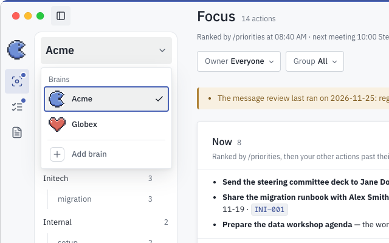
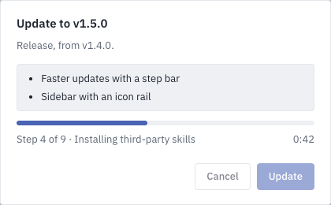

# Corvus

Corvus is the local app of Work: it shows the actions and the notes of your brains, and lets you change them without an agent. It opens in a window of its own on macOS, Windows and Linux, or in a browser tab. Everything stays on your computer: the server listens on `127.0.0.1` only, keeps no copy of your data and writes every change into the brain's own Markdown files, which your agents read too. Back to the [root README](../../README.md).


This guide first lists what Corvus does, then shows how its parts fit together, how to install it and how to launch it. It ends with a tour of the views and the keyboard shortcuts.

## What it does

Corvus brings the registers of every brain into one window, so that the day's work can be read and updated in a few clicks.

- Focus answers one question on one page, what to do now: the ranking of the `/priorities` agent skill, then what is overdue, due today, in progress, to chase, waiting on someone else and due in the week ahead.
- Every action can be changed in place (status, owner, due date, priority, subtasks, notes), and every change can be undone.
- Actions shows the same actions as a list, a board or a timeline, with the same filters, and Docs shows them next to the notes of each project.
- One search field looks through the actions and every Markdown document of the brain.
- A selector switches between your brains without restarting anything, and each brain keeps its own colour and logo.
- Sync saves and sends the changes of each brain, and brings in the changes made on another computer.
- The sidebar and the detail panel can be resized, and the page follows the light or dark setting of the system.

## How it works

The window only displays a page. A small server on your computer reads the brains and writes the changes, and Sync is the only part that talks to the network.



The diagram shows why Corvus and your agents never disagree: both go through the same files and the same `action.py` rules, and a brain only leaves the computer when you ask Sync to send it. The page itself loads nothing from the Internet (no CDN, no outside font or script). Two features use the network: Sync, with each brain's own Git remote, and Update, which looks for a newer release of Work.

## Install and launch

Corvus can be installed as an app or started from a terminal; both open the same page.

**As an app.** Run this once from the root of Work:

```sh
uv run tools/tasks-web/install-app.py
```

It adds a **Corvus** entry: an app to drag to the Dock on macOS, a Start Menu shortcut on Windows, an entry of the applications menu on Linux. A click starts the local server when it is not running and opens the page. On macOS and Windows it opens in a native window (pywebview, downloaded once by `uv` at install). On Linux, and whenever the native window cannot open, it opens in a Chrome, Chromium or Edge app window, and failing that in the default browser. Clicking the icon again brings back the open window. **Quit Corvus…**, in the **⋯** menu, stops the server and closes the window; closing the window alone leaves the server running, so the next launch is immediate.

**From a terminal.** From the root of Work:

```sh
uv run tools/tasks-web/tasks-web.py
```

Then open `http://127.0.0.1:8765/` (`--port N` for another port, `Ctrl+C` to stop). `--brain <folder>` picks the default brain and `WORK_DIR` another Work root. The details of each system are in [Install the app](REFERENCE.md#install-the-app).

## Tour

The sidebar holds three sections, Focus, Actions and Docs, and Settings at the bottom. Under the title, a row of tabs lists the views of the section (for example List, Board and Timeline). A section opens on the view used last, and its views share the same filters. Sync is the button at the top right. The tour follows that order, then shows the brains, the window and the updates.

### Focus

**Focus** is the opening page. It brings together the ranking that the `/priorities` agent skill writes for the brain and the actions of the registers, so that the next thing to do is at the top. A line under the title says when the ranking was written and names the next meeting.

- **Now** lists the ranked items to do now, then the other actions past their due date or due today.
- **To prepare**, **Conflicts** and **New requests** come from the ranking.
- **In progress**, **To chase**, **Waiting on others** and **This week** come from the registers; To chase and Waiting on others are sorted by owner, and each follow-up carries a draft of the message with a button to copy it.

Each action appears once, in the first block that fits, and an empty block is left out. An action ID in a ranked item opens that action. When a project is chosen, the ranking keeps only the items that cite one of its actions, and the line under the title says so. When the ranking is not today's, the page shows the actions alone and says why.

### Actions: List, Board and Timeline

The three views show the same actions with the same filters.

- **List** groups the actions by project and group, each with its progress and its overdue count. A click on the status or the due date changes it in place; a click on a row opens the detail panel with the fields, the subtasks and the history of notes. Every write goes through `action.py` and can be undone, and dragging the left edge of the panel widens it.
- **Board** has four columns, To do, In progress, Waiting and Recently done. Dragging a card changes its status. The board shows your own cards unless you switch to Everyone.
- **Timeline** places the actions with a deadline on a chronological frieze (2 weeks, 6 weeks or a quarter), one lane per project, overdue first. Those without a deadline wait in a tray below: dropping one on a day plans it.


### Docs: Docs and Archives

**Docs** shows the notes, sources, workstreams, journal and project pages of the brain, with a reader and a Markdown editor for working notes. **Archives** lists the clients, missions and projects moved to an archive, read-only, and can bring one back. The search field, in every view, looks through the actions and every Markdown document at once.


### Sync

Each brain is a Git repository. The Sync button at the top right shows, for the current brain, how many changes made on another computer are waiting online, or a dot when notes are waiting to be saved and sent; a click opens the Sync view. That view shows one card per brain. **Save and send** records the changed notes and sends them to the brain's online copy, through the brain's own Git hooks. Corvus checks the online copies when it opens and every ten minutes; when a brain is behind, its card offers **Sync**, which brings the changes in as a fast-forward only, never with a merge commit or a rewrite of history.


### Settings: Settings and Tools

**Settings** shows what is left to set up in the workspace and the settings that can be changed. **Tools** runs the workspace commands; none of them sends anything to an external service.

### Brains

The brain's name at the top of the sidebar opens the brain menu: it switches brain without restarting the server, and **Add brain** creates a new private brain with its own Git repository. Each brain has its own colour and pixel logo, so the brain being edited is always visible. A sideways swipe over the sidebar moves to the next brain.



### Sidebar, window and dark mode

On the left, a rail holds the three sections and, at the bottom, Settings. Next to it, the project card lists the projects of the brain; its edge can be dragged to widen it. The sidebar button, or the `[` key, folds the card away. The rail then shows the main projects by the prefix of their action IDs, such as ACME for ACME-004: the pointer on one gives its full name and its number of open actions, and a click filters the view. When a client has several missions, the pointer on its code opens a small menu of them, each with its open actions, and a click there filters that mission. In Archives, Tools, Settings and Sync, which the projects do not filter, the card steps aside. The window has the same layout on macOS, Windows and Linux; on macOS it has no separate title bar, and its three buttons sit at the top left, before the sidebar button. The page follows the light or dark setting of the system.


### Update

When a newer release of Work exists, an **Update** button appears in the sidebar. The dialog shows the release notes and, once confirmed, a step bar through the install; the brains are never touched.



## Keyboard shortcuts

The single keys do not apply while typing in a field. `?` shows their help, and the tooltips recall them.

| Key | Effect |
|---|---|
| `/` | Search the actions and the documents |
| `n` | New action |
| `1` to `3` | Focus, Actions, Docs, each on the view used last |
| `v`, ⇧ `v` | Next or previous view of the section (List, Board, Timeline…) |
| `j` `k`, `↓` `↑` | Next or previous action (Focus, List, Board, Timeline) |
| `←` `→` `↑` `↓` | On a Timeline chip: by date, and by project |
| Alt `←` `→` | On a Timeline chip: move its deadline by a day (with Shift, a week) |
| Enter | Open the details of the selected action |
| `s` | Status menu of the selected action |
| `d` | Due date of the selected action |
| Esc | Close the menu, the drawer or the panel; in the search field, clear it and go back to the view it left |
| ⌘ Enter | Save the panel now, create the action, or save the note being edited |
| ⌘ Z | Undo the last write |
| `[` | Fold the project card or the sidebar, or open it again (the drawer, under 900 px) |
| `?` | Shortcuts help |
| ⌘ B, I, U, K, ⇧ ⌘ X | In a note being written: bold, italic, underline, link, strikethrough |

In a list, only the selected row (otherwise the first one) is in the tab order: Tab goes through its buttons, and `j` and `k` move to the others.

## Reference

[`REFERENCE.md`](REFERENCE.md) holds the details:
- [Install the app](REFERENCE.md#install-the-app) and the [layout](REFERENCE.md#layout).
- The views and their routes: [Focus](REFERENCE.md#focus), [Actions](REFERENCE.md#actions-and-detail-panel), [Board](REFERENCE.md#board), [Timeline](REFERENCE.md#timeline), [Groups](REFERENCE.md#groups), [Docs and Search](REFERENCE.md#docs-and-search), [Archives](REFERENCE.md#archives), [Tools](REFERENCE.md#tools), [Sync](REFERENCE.md#sync), [Update](REFERENCE.md#update) and [Settings](REFERENCE.md#settings).
- [Several brains](REFERENCE.md#several-brains).
- The [priorities file format](REFERENCE.md#priorities-file).
- [Data and security](REFERENCE.md#data-and-security).
- The [code layout](REFERENCE.md#code-layout).
